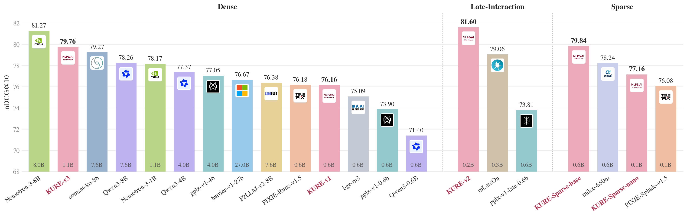
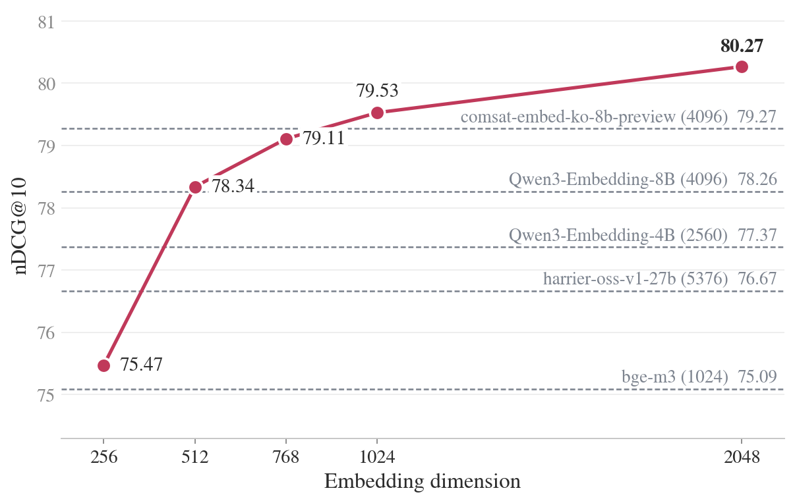
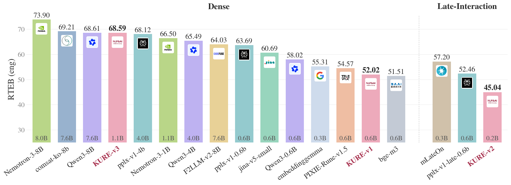
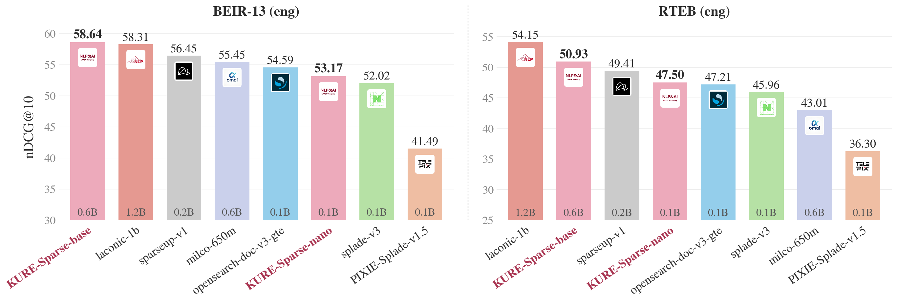

# 🔎 KURE: Korea University REtrieval models

<p align="center" width="100%">

</p>

[English](README.md) | [한국어](README_ko.md)

**KURE** is a family of Korean-English retrieval embedding models developed by the [NLP & AI Lab](http://nlp.korea.ac.kr/) and the [HIAI Institute](http://hiai.korea.ac.kr) at Korea University.

## Update Logs

- 2026.10.20: [🤗 KURE-v3](https://huggingface.co/nlpai-lab/KURE-v3) released with [API](https://kure.kullm.ai/).
- 2026.10.12: [🤗 KURE-Sparse-base](https://huggingface.co/nlpai-lab/KURE-Sparse-base) and [🤗 KURE-Sparse-nano](https://huggingface.co/nlpai-lab/KURE-Sparse-nano) released.
- 2026.10.01: [🤗 KURE-Reranker-base](https://huggingface.co/nlpai-lab/KURE-Reranker-base) and [🤗 KURE-Reranker-nano](https://huggingface.co/nlpai-lab/KURE-Reranker-nano) released.
- 2026.08.29: [🤗 KURE-v2](https://huggingface.co/nlpai-lab/KURE-v2) released.
- 2024.12.21: [🤗 KURE-v1](https://huggingface.co/nlpai-lab/KURE-v1) released with the MTEB-ko-retrieval leaderboard.
- 2024.10.02: [🤗 KoE5](https://huggingface.co/nlpai-lab/KoE5) and [🤗 ko-triplet-v1.0](https://huggingface.co/datasets/nlpai-lab/ko-triplet-v1.0) released.

## Models

| Model | Type | Params | Base model |
|---|---|---|---|
| [KURE-v3](https://huggingface.co/nlpai-lab/KURE-v3) | Dense (single-vector) | 1.1B | [nvidia/Nemotron-3-Embed-1B-BF16](https://huggingface.co/nvidia/Nemotron-3-Embed-1B-BF16) |
| [KURE-Sparse-base](https://huggingface.co/nlpai-lab/KURE-Sparse-base) | Learned Sparse Retrieval (LSR) | 593M | [omai-research/milco-650m](https://huggingface.co/omai-research/milco-650m) |
| [KURE-Sparse-nano](https://huggingface.co/nlpai-lab/KURE-Sparse-nano) | Learned Sparse Retrieval (LSR) | 149M | [nlpai-lab/KURE-v2-unsupervised](https://huggingface.co/nlpai-lab/KURE-v2-unsupervised) |
| [KURE-Reranker-base](https://huggingface.co/nlpai-lab/KURE-Reranker-base) | Reranker (cross-encoder) | 1.7B | [Qwen/Qwen3-1.7B](https://huggingface.co/Qwen/Qwen3-1.7B) |
| [KURE-Reranker-nano](https://huggingface.co/nlpai-lab/KURE-Reranker-nano) | Reranker (cross-encoder) | 149M | [skt/A.X-Encoder-base](https://huggingface.co/skt/A.X-Encoder-base) |
| [KURE-v2](https://huggingface.co/nlpai-lab/KURE-v2) | Late-interaction (multi-vector) | 154M | [skt/A.X-Encoder-base](https://huggingface.co/skt/A.X-Encoder-base) |
| [KURE-v1](https://huggingface.co/nlpai-lab/KURE-v1) | Dense (single-vector) | 568M | [BAAI/bge-m3](https://huggingface.co/BAAI/bge-m3) |
| [KoE5](https://huggingface.co/nlpai-lab/KoE5) | Dense (single-vector) | 560M | [intfloat/multilingual-e5-large](https://huggingface.co/intfloat/multilingual-e5-large) |


## Environment

We use [uv](https://docs.astral.sh/uv/) to manage the environment.

```bash
uv sync                                                # dense, sparse and cross-encoder models
uv sync --extra late-interaction --no-default-groups   # KURE-v2 with PyLate
```

## Usage

### API

KURE-v3, KURE-Sparse-{base, nano} and KURE-Reranker-nano are served at [kure.kullm.ai](https://kure.kullm.ai/). Sign in with GitHub there to get an API key.
Each request takes up to 8 texts (100 documents for reranking).

| Endpoint | Models |
|---|---|
| `/embeddings` | `kure-v3` |
| `/sparse-embeddings` | `kure-sparse-base`, `kure-sparse-nano` |
| `/rerank` | `kure-reranker-nano` |

```python
import os

import requests
from openai import OpenAI

BASE_URL = "https://kure.kullm.ai/api/v1"
API_KEY = os.environ["KURE_API_KEY"]

query = "훈민정음은 언제 만들어졌나요?"
documents = [
    "세종대왕은 1443년에 훈민정음을 창제하고 1446년에 이를 반포하였다.",
    "김치는 배추나 무를 소금에 절인 뒤 고춧가루와 젓갈을 넣어 발효시킨 음식이다.",
    "한라산은 해발 1,947m로 남한에서 가장 높은 산이며 제주도 중앙에 자리한다.",
]

# KURE-v3 (OpenAI-compatible). input_type adds the query or document prompt. Vectors are 2048-d, pass dimensions=(256 to 2048) for a smaller Matryoshka size
client = OpenAI(base_url=BASE_URL, api_key=API_KEY)
query_embedding = client.embeddings.create(
    model="kure-v3", input=query, extra_body={"input_type": "query"}
)
document_embeddings = client.embeddings.create(
    model="kure-v3", input=documents, extra_body={"input_type": "document"}
)

headers = {"Authorization": f"Bearer {API_KEY}"}

# KURE-Sparse returns vocabulary ids (indices) and their weights (values)
sparse = requests.post(
    f"{BASE_URL}/sparse-embeddings",
    headers=headers,
    json={"model": "kure-sparse-nano", "input": documents, "input_type": "document"},
).json()

# KURE-Reranker returns the documents sorted by relevance_score (0 to 1, higher is more relevant)
ranked = requests.post(
    f"{BASE_URL}/rerank",
    headers=headers,
    json={"model": "kure-reranker-nano", "query": query, "documents": documents},
).json()
```

### KURE-Dense

```python
from sentence_transformers import SentenceTransformer

model = SentenceTransformer("nlpai-lab/KURE-v3", model_kwargs={"attn_implementation": "flash_attention_2"})
# model = SentenceTransformer("nlpai-lab/KURE-v3", model_kwargs={"attn_implementation": "flash_attention_2"}, truncate_dim=1024)  # smaller Matryoshka vectors

# KURE-v2 is late-interaction and needs sentence-transformers>=6.0:
# from sentence_transformers import MultiVectorEncoder
# model = MultiVectorEncoder("nlpai-lab/KURE-v2")

# model = SentenceTransformer("nlpai-lab/KURE-v1")
# model = SentenceTransformer("nlpai-lab/KoE5", prompts={"query": "query: ", "document": "passage: "})

query = "훈민정음은 언제 만들어졌나요?"
documents = [
    "세종대왕은 1443년에 훈민정음을 창제하고 1446년에 이를 반포하였다.",
    "김치는 배추나 무를 소금에 절인 뒤 고춧가루와 젓갈을 넣어 발효시킨 음식이다.",
    "한라산은 해발 1,947m로 남한에서 가장 높은 산이며 제주도 중앙에 자리한다.",
]

# encode_query / encode_document add each model's query and document prompts
query_embeddings = model.encode_query(query)
document_embeddings = model.encode_document(documents)

# Higher is more relevant (cosine, or MaxSim for KURE-v2)
scores = model.similarity(query_embeddings, document_embeddings)
```

### KURE-Sparse

```python
from sentence_transformers import SparseEncoder

model = SparseEncoder("nlpai-lab/KURE-Sparse-nano", trust_remote_code=True)
# model = SparseEncoder("nlpai-lab/KURE-Sparse-base", trust_remote_code=True)

query = "훈민정음은 언제 만들어졌나요?"
documents = [
    "세종대왕은 1443년에 훈민정음을 창제하고 1446년에 이를 반포하였다.",
    "김치는 배추나 무를 소금에 절인 뒤 고춧가루와 젓갈을 넣어 발효시킨 음식이다.",
    "한라산은 해발 1,947m로 남한에서 가장 높은 산이며 제주도 중앙에 자리한다.",
]

# encode_query / encode_document add the query and document markers KURE-Sparse-nano expects
query_embeddings = model.encode_query(query)
document_embeddings = model.encode_document(documents)

# Dot-product scores (higher is more relevant)
scores = model.similarity(query_embeddings, document_embeddings)
```

### KURE-Reranker

```python
from sentence_transformers import CrossEncoder

model = CrossEncoder("nlpai-lab/KURE-Reranker-nano", max_length=8192)
# model = CrossEncoder("nlpai-lab/KURE-Reranker-base", max_length=8192)

query = "훈민정음은 언제 만들어졌나요?"
documents = [
    "세종대왕은 1443년에 훈민정음을 창제하고 1446년에 이를 반포하였다.",
    "김치는 배추나 무를 소금에 절인 뒤 고춧가루와 젓갈을 넣어 발효시킨 음식이다.",
    "한라산은 해발 1,947m로 남한에서 가장 높은 산이며 제주도 중앙에 자리한다.",
]

# Higher is more relevant
results = model.rank(query, documents, return_documents=True)
```

## Evaluation

<p align="center">
  
</p>

We evaluate on the nine **MTEB(kor, v2) Retrieval** tasks with the latest [mteb](https://github.com/embeddings-benchmark/mteb) (v2), using the Korean subsets only (Belebele: `kor_Hang-kor_Hang`; MLDR is the mean of its dev/test splits):

- [Ko-StrategyQA](https://huggingface.co/datasets/taeminlee/Ko-StrategyQA): Korean ODQA multi-hop retrieval (translated StrategyQA)
- [AutoRAGRetrieval](https://huggingface.co/datasets/yjoonjang/markers_bm): document retrieval over parsed PDFs in finance, public sector, healthcare, law, and commerce
- [MIRACLRetrieval](https://huggingface.co/datasets/miracl/miracl): Wikipedia-based retrieval, ~1.5M documents
- [PublicHealthQA](https://huggingface.co/datasets/xhluca/publichealth-qa): medical / public-health domain retrieval
- [BelebeleRetrieval](https://huggingface.co/datasets/facebook/belebele): FLORES-200-based retrieval
- [MrTidyRetrieval](https://huggingface.co/datasets/mteb/mrtidy): Wikipedia-based retrieval, ~1.5M documents
- [MultiLongDocRetrieval](https://huggingface.co/datasets/Shitao/MLDR): long-document retrieval across domains
- [LawIRKo](https://huggingface.co/datasets/on-and-on/lawgov_ir-ko): Korean statute / case-law retrieval
- [SQuADKorV1Retrieval](https://huggingface.co/datasets/yjoonjang/squad_kor_v1): KorQuAD v1 passage retrieval

<details>
<summary><h3>Dense Leaderboard</h3></summary>

Dense models are evaluated with mteb, and late-interaction models with mteb + PLAID (4-bit) retrieval. Models with results in the official [MTEB results repository](https://github.com/embeddings-benchmark/results) use those scores, and the others are run with `eval/dense/evaluate.py`. To evaluate a model, pass its name and paradigm:

```bash
uv run python eval/dense/evaluate.py nlpai-lab/KURE-v3 single-vector
uv run --extra late-interaction --no-default-groups python eval/dense/evaluate.py nlpai-lab/KURE-v2 multi-vector
```

Average over the nine tasks. Per-task scores are in [`eval/dense/results/README.md`](eval/dense/results/README.md) and on the official [MTEB Leaderboard](https://mteb-leaderboard.hf.space/benchmark/MTEB(kor%2C%20v2)?types=Retrieval&s.summary=meanTask&d.summary=desc).

| Model | Type | Params | Avg nDCG@10 | Avg Recall@10 |
|---|---|---:|---:|---:|
| **[nlpai-lab/KURE-v2](https://huggingface.co/nlpai-lab/KURE-v2)** | Late-interaction | 154M | **0.8160** | **0.8921** |
| nvidia/Nemotron-3-Embed-8B-BF16 | Dense | 8.0B | 0.8127 | 0.8934 |
| yjoonjang/colbert-ko-en-v2 | Late-interaction | 149M | 0.8063 | 0.8827 |
| **[nlpai-lab/KURE-v3](https://huggingface.co/nlpai-lab/KURE-v3)** | Dense | 1.1B | 0.8027 | 0.8857 |
| sionic-ai/comsat-embed-ko-8b-preview | Dense | 7.6B | 0.7927 | 0.8876 |
| lightonai/mLateOn | Late-interaction | 307M | 0.7906 | 0.8740 |
| Qwen/Qwen3-Embedding-8B | Dense | 7.6B | 0.7826 | 0.8815 |
| nvidia/Nemotron-3-Embed-1B-BF16 | Dense | 1.1B | 0.7817 | 0.8690 |
| Qwen/Qwen3-Embedding-4B | Dense | 4.0B | 0.7737 | 0.8753 |
| perplexity-ai/pplx-embed-v1-4b | Dense | 4.0B | 0.7705 | 0.8699 |
| microsoft/harrier-oss-v1-27b | Dense | 27.0B | 0.7667 | 0.8624 |
| dragonkue/snowflake-arctic-embed-l-v2.0-ko | Dense | 568M | 0.7653 | 0.8609 |
| codefuse-ai/F2LLM-v2-8B | Dense | 7.6B | 0.7638 | 0.8593 |
| telepix/PIXIE-Rune-v1.5 | Dense | 568M | 0.7618 | 0.8596 |
| **[nlpai-lab/KURE-v1](https://huggingface.co/nlpai-lab/KURE-v1)** | Dense | 568M | 0.7616 | 0.8629 |
| nvidia/llama-nemotron-embed-1b-v2 | Dense | 1.2B | 0.7564 | 0.8560 |
| dragonkue/BGE-m3-ko | Dense | 568M | 0.7547 | 0.8513 |
| BAAI/bge-m3 | Dense | 568M | 0.7509 | 0.8588 |
| jinaai/jina-embeddings-v5-text-small-retrieval | Dense | 596M | 0.7419 | 0.8434 |
| perplexity-ai/pplx-embed-v1-0.6b | Dense | 596M | 0.7390 | 0.8377 |
| perplexity-ai/pplx-embed-v1-late-0.6b | Late-interaction | 596M | 0.7381 | 0.8328 |
| **[nlpai-lab/KoE5](https://huggingface.co/nlpai-lab/KoE5)** | Dense | 560M | 0.7337 | 0.8300 |
| **[nlpai-lab/KURE-v2-unsupervised](https://huggingface.co/nlpai-lab/KURE-v2-unsupervised)** | Late-interaction | 154M | 0.7283 | 0.8268 |
| google/embeddinggemma-300m | Dense | 308M | 0.7254 | 0.8383 |
| Qwen/Qwen3-Embedding-0.6B | Dense | 596M | 0.7140 | 0.8222 |
| dragonkue/colbert-ko-0.1b | Late-interaction | 149M | 0.6776 | 0.7723 |
| yjoonjang/colbert-ko-v1 | Late-interaction | 149M | 0.6282 | 0.7212 |

Truncated to 1,024 dimensions, KURE-v3 keeps 99% of its full-size score and still outperforms comsat-embed-ko-8b-preview and Qwen3-Embedding-8B (4,096 dimensions). Per-dimension scores are in [`eval/dense/results/README.md`](eval/dense/results/README.md#kure-v3-at-matryoshka-dimensions).

<p align="center">
  
</p>

### RTEB (eng)

Dense and late-interaction models are also evaluated on [RTEB](https://huggingface.co/blog/rteb), an English retrieval benchmark, using its eight public tasks outside the code domain. The average differs from the RTEB leaderboard score, which also covers private and code tasks. Per-task scores are in [`eval/dense/results/README.md`](eval/dense/results/README.md).

```bash
uv run python eval/dense/evaluate.py nlpai-lab/KURE-v3 single-vector --suite rteb_eng
```

<p align="center">
  
</p>

</details>

<details>
<summary><h3>Sparse Leaderboard</h3></summary>

Learned sparse models are evaluated on the same nine tasks under the same conventions, with mteb's `SparseEncoder` wrapper in bf16 at up to 8,192 tokens and without pruning the vectors. Next to nDCG@10, we report the average number of active dimensions per query and per document, and FLOPs. To evaluate a sparse model:

```bash
uv run python eval/sparse/evaluate.py nlpai-lab/KURE-Sparse-nano
```

Results are averaged over the nine Korean retrieval tasks. The dashed lines mark dense models for reference. Per-task scores, along with English BEIR and RTEB results, are in [`eval/sparse/results/README.md`](eval/sparse/results/README.md).

<p align="center">
  
</p>

| Model | Params | Avg nDCG@10 | Query dims | Document dims | FLOPs |
|---|---:|---:|---:|---:|---:|
| **[nlpai-lab/KURE-Sparse-base](https://huggingface.co/nlpai-lab/KURE-Sparse-base)** | 593M | **0.7984** | 100 | 1,897 | 36.5 |
| omai-research/milco-650m | 593M | 0.7824 | 105 | 1,167 | 32.3 |
| **[nlpai-lab/KURE-Sparse-nano](https://huggingface.co/nlpai-lab/KURE-Sparse-nano)** | 149M | 0.7716 | 147 | 843 | 23.0 |
| telepix/PIXIE-Splade-v1.5 | 149M | 0.7608 | 117 | 1,541 | 37.3 |
| yjoonjang/splade-ko-v1 | 149M | 0.7526 | 109 | 742 | 29.1 |
| telepix/PIXIE-Splade-v1.0 | 149M | 0.6636 | 121 | 625 | 22.4 |
| opensearch-project/opensearch-neural-sparse-encoding-multilingual-v1 | 167M | 0.5444 | 29 | 176 | 6.8 |

### English Retrieval (BEIR, RTEB)

Sparse models are also evaluated on two English benchmarks with nDCG@10: the 13 BEIR tasks (BEIR-13), and the **eight public English** tasks of [RTEB](https://huggingface.co/blog/rteb) outside the code domain. SparseUp runs at its own length limits (128 query and 512 document tokens), and the other models at up to 8,192 tokens. The RTEB average differs from the RTEB leaderboard score, which also covers private and code tasks.

```bash
uv run python eval/sparse/evaluate.py nlpai-lab/KURE-Sparse-base --suite beir_eng --max-seq-length 8192
uv run python eval/sparse/evaluate.py nlpai-lab/KURE-Sparse-base --suite rteb_eng --max-seq-length 8192
```

<p align="center">
  
</p>

Per-task scores are in [`eval/sparse/results/README.md`](eval/sparse/results/README.md).

</details>

<details>
<summary><h3>Reranker Leaderboard</h3></summary>

Rerankers are evaluated on the same nine tasks with the protocol of [reranker-simple-benchmark](https://github.com/instructkr/reranker-simple-benchmark): each query's candidates are its gold documents plus, as negatives, the BM25 top-50 minus the golds, every model runs in bf16 at up to 8,192 tokens, and we report nDCG@10 with throughput in pairs per second (PPS), measured on one NVIDIA RTX A6000 48GB. To evaluate a reranker:

```bash
bash eval/cross-encoder/fetch_eval_assets.sh   # once: the BM25 candidate pools
uv run python eval/cross-encoder/evaluate.py nlpai-lab/KURE-Reranker-nano --speed
```

Results are averaged over the nine Korean retrieval tasks. Per-task nDCG@10 and PPS are in [`eval/cross-encoder/results/README.md`](eval/cross-encoder/results/README.md).

<p align="center">
  
</p>

</details>

## Training Details

### KURE-v3

Training code in [`train/dense`](train/dense).

- Fine-tuned from [nvidia/Nemotron-3-Embed-1B-BF16](https://huggingface.co/nvidia/Nemotron-3-Embed-1B-BF16) by distilling a teacher's scores over each query's candidates on the KURE-v2 SFT data (min-max normalized KL), up to 8,192 tokens, 1 epoch.
- Matryoshka training at 2,048, 1,024, 512 and 256 dimensions.

### KURE-Sparse

Training code in [`train/sparse`](train/sparse).

- Distilled from Qwen3-Reranker teacher on the KURE-v2 SFT data with an in-batch contrastive term plus a KL term over each query's candidates, an L1 sparsity regularization on queries and documents, up to 8,192 tokens, 1 epoch.
- **KURE-Sparse-base**: fine-tuned from [omai-research/milco-650m](https://huggingface.co/omai-research/milco-650m), scoring over 30,522 English pivot terms plus 250,002 source-language tokens.
- **KURE-Sparse-nano**: the A.X-Encoder-base MLM head grafted onto [KURE-v2-unsupervised](https://huggingface.co/nlpai-lab/KURE-v2-unsupervised), pre-finetuned on 20.7M pairs, then fine-tuned. Resulting in 36,282 vocabulary terms.

### KURE-Reranker

Training code in [`train/cross-encoder`](train/cross-encoder).

- Distilled from a Qwen3-Reranker teacher with pointwise MSE on the KURE-v2 SFT data flattened to 33.3M query-document pairs, 1 epoch.
- **KURE-Reranker-base**: [Qwen/Qwen3-1.7B](https://huggingface.co/Qwen/Qwen3-1.7B) scored as logit("yes") − logit("no") over the Qwen3-Reranker template, up to 8,192 tokens.
- **KURE-Reranker-nano**: [skt/A.X-Encoder-base](https://huggingface.co/skt/A.X-Encoder-base) with a single-logit head, up to 8,192 tokens.

### KURE-v2

The full two-stage training code is in [`train/late-interaction`](train/late-interaction).

- Built on [skt/A.X-Encoder-base](https://huggingface.co/skt/A.X-Encoder-base) with a multi-layer projection head (128-d per token).
- **Stage 1 (PFT)**: large in-batch contrastive learning on 20.7M weakly related Korean/English pairs, released as [KURE-v2-unsupervised](https://huggingface.co/nlpai-lab/KURE-v2-unsupervised).
- **Stage 2 (SFT)**: contrastive learning + KL distillation from a reranker teacher on 3.03M triplets with hard negatives and false-negative filtering.

### KURE-v1

- Fine-tuned from [BAAI/bge-m3](https://huggingface.co/BAAI/bge-m3) on ~2M Korean query-document-hard-negative(5) pairs.
- CachedGISTEmbedLoss, batch size 4,096, lr 2e-5, 1 epoch.

### KoE5

- Fine-tuned from [intfloat/multilingual-e5-large](https://huggingface.co/intfloat/multilingual-e5-large) on [ko-triplet-v1.0](https://huggingface.co/datasets/nlpai-lab/ko-triplet-v1.0) (~700K+ examples).
- CachedMultipleNegativesRankingLoss, batch size 512, lr 1e-5, 1 epoch. Requires `query: ` / `passage: ` prefixes.

## Serving

Index-size and latency benchmarks of KURE-v2 across ANN backends, token pooling and binary quantization, with runnable configurations, are in [`deploy/late-interaction`](deploy/late-interaction).

## License

```MIT```

## Citation

If you find our models helpful, please consider citing:

```bibtex
@misc{kure-v3,
  title  = {KURE-v3: a Korean-English bilingual dense retriever},
  author = {Jang, Youngjoon and Son, Junyoung and Lee, Taemin and Hong, Seongtae and Lee, Jungseob and Lim, Heuiseok},
  year   = {2026},
  url    = {https://huggingface.co/nlpai-lab/KURE-v3},
}
```

```bibtex
@misc{kure-reranker,
  title  = {KURE-Reranker: Korean-English bilingual reranking models},
  author = {Jang, Youngjoon and Hong, Seongtae and Son, Junyoung and Lee, Taemin and Lim, Heuiseok},
  year   = {2026},
  url    = {https://huggingface.co/nlpai-lab/KURE-Reranker-base},
}
```

```bibtex
@misc{kure-v2,
  title  = {KURE-v2: a Korean-English bilingual late-interaction retriever},
  author = {Jang, Youngjoon and Son, Junyoung and Lee, Taemin and Hong, Seongtae and Lim, Heuiseok},
  year   = {2026},
  url    = {https://huggingface.co/nlpai-lab/KURE-v2},
}
```

```bibtex
@inproceedings{jang2025kure,
  title={KURE: Embedding Model for Korean-Specific Retrieval},
  author={Jang, Youngjoon and Son, Junyoung and Lee, Taemin and Hong, Seongtae and Park, JeongBae and Lim, Heuiseok},
  booktitle={Annual Conference on Human and Language Technology},
  pages={129--134},
  year={2025},
  organization={Human and Language Technology}
}
```

```bibtex
@inproceedings{jang2024koe5,
  title={KoE5: A New Dataset and Model for Improving Korean Embedding Performance},
  author={Jang, Youngjoon and Son, Junyoung and Park, Chanjun and Choi, Soonwoo and Lee, Byeonggoo and Lee, Taemin and Lim, Heuiseok},
  booktitle={Annual Conference on Human and Language Technology},
  pages={239--244},
  year={2024},
  organization={Human and Language Technology}
}
```
